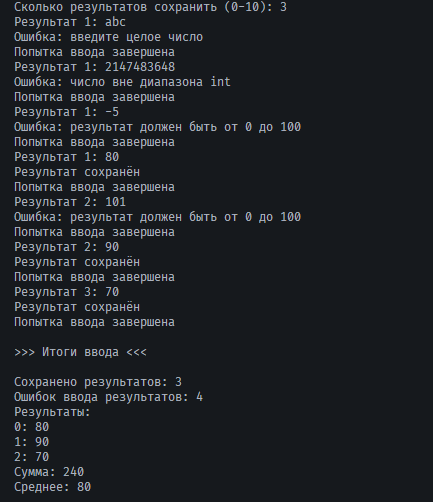

# Практическая работа №25

Автор: Алексеевская Елена

Группа: ИСП-251

## Тема

Исключения в C#.

## Что реализовано

- ввод количества через TryParse;
- повторный ввод результатов после ошибок;
- обработка FormatException и OverflowException;
- проверка диапазона через throw и ArgumentOutOfRangeException;
- завершение каждой попытки через finally;
- сохранение корректных результатов и вывод статистики.

## Короткие ответы

1. С какой строки продолжается выполнение после обработанного исключения?

Ответ: После выполнения подходящего блока `catch` программа продолжает работу со строки, следующей за всей конструкцией `try-catch`, а не с места возникновения ошибки. 

2. Для чего нужен finally и почему он не заменяет catch?

Ответ: Блок `finaly` выполняется при завершении конструкции независимо от того, возникло исключение или нет. Он подходит для завершающих действий. Он не обрабатывает исключение и не выводит программу из аварийной ситуации, поэтому для обработки ошибки нужен `catch`

3. Когда удобнее использовать TryParse вместо Parse с обработкой исключения?

Ответ: `TryParse` удобнее при обычной проверке ввода, когда неверное значение ожидаемо. Метод возвращает `false`, если строку не удалось преобразовать, и не создает исключение из-за такого вывода. `Parse` уместен, когда ошибка действительно исключительная и ее нужно обработать отдельно по типу.

## Результат
